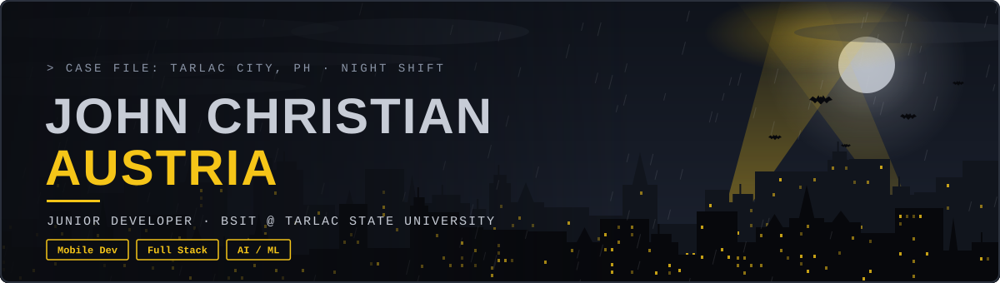
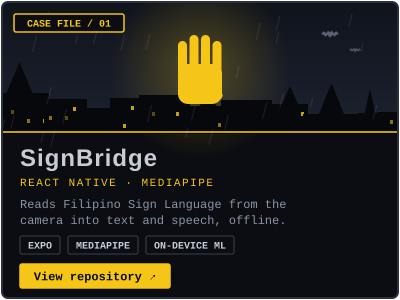
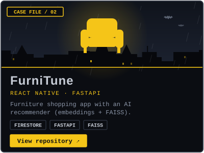
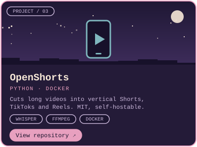
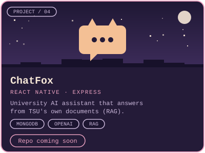

  

  
  
  

  
  
  

## ☾ About Me

I'm **John Christian Austria**, a junior developer from Tarlac, Philippines, turning ML into apps
people can use: offline Filipino Sign Language translation, AI furniture recommendations, and
automatic short-video clipping.

I graduated **Cum Laude in BS Information Technology from Tarlac State University** (2026) and am
open to junior developer roles as of November 2026.

## ☾ Tech Stack

**Frontend & Mobile**: React Native, React, Vite, Tailwind CSS, HTML, CSS, JavaScript

**Backend**: Node.js, Express, Python, FastAPI, C#/.NET, Java

**Data, Cloud & Tools**: Firestore, MongoDB, PostgreSQL, MySQL, AWS S3, Docker, Git

## ☾ Featured Projects

<table>
  <tr>
    <td></td>
    <td></td>
  </tr>
  <tr>
    <td></td>
    <td></td>
  </tr>
</table>

<!-- Owner: JcXplore. Last reviewed 2026-11-26.
     Review when: you accept a job (remove the "Open to" badge and line), ship or retire a project,
     publish ChatFox, or start a new job search.
     Cards and banner are generated SVGs in assets/; edit the text inside them directly. -->
